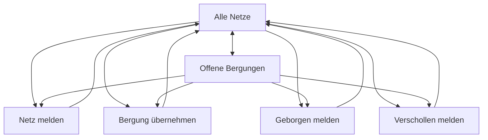
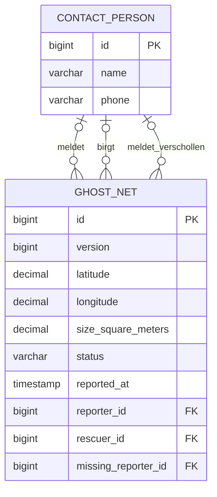
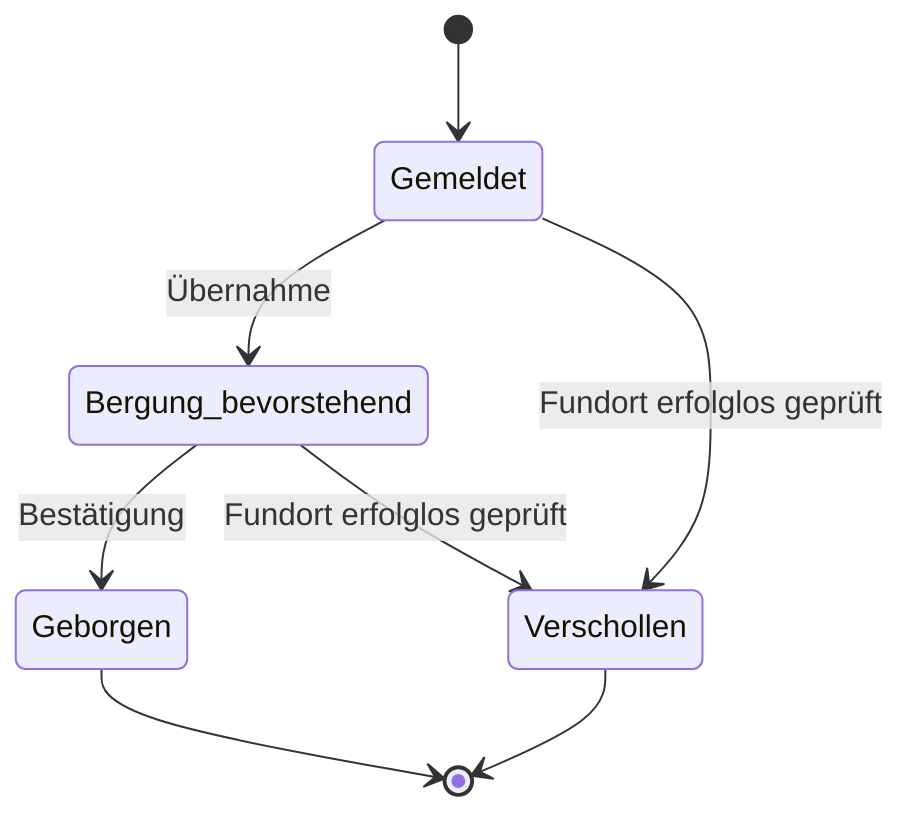

# Ghost Net Fishing – Entwurf und Entscheidungen, Version 0.1.1

Technischer Entwurf des Prototyps. Die Diagramme beschreiben das fachliche Modell und die selbst definierten Anwendungskomponenten.

## Umfang

| Anforderung | Geplante Umsetzung |
|---|---|
| Netz melden (MUST) | GPS, Fläche in m², optionale vollständige Kontaktangaben |
| Bergung übernehmen (MUST) | Name und Telefonnummer, exklusiv je Netz |
| Offene Netze anzeigen (MUST) | Status Gemeldet oder Bergung bevorstehend |
| Geborgen melden (MUST) | Nach Übernahme, Abgleich mit hinterlegten Kontaktdaten |
| Verschollen melden (COULD) | Für offene Netze, vollständige Kontaktangaben notwendig |

Nicht enthalten: Weltkarte, Abstimmung und Umverteilung von Bergungen.

## Entscheidungen und Grenzen

- Spring MVC/Thymeleaf für serverseitige Webseiten; Spring Beans für Controller und Service.
- JPA/Hibernate mit H2 im Dateimodus. Der Datenordner ist relativ zum Startverzeichnis.
- Eine Fläche in Quadratmetern konkretisiert die in der Aufgabe nicht spezifizierte Größeneinheit.
- Netze besitzen drei optionale Fremdschlüssel auf Personen: meldend, bergend, verschollen meldend.
- Eine Person wird bei exakt gleichen, außen getrimmten Name-/Telefonwerten wiederverwendet. Schreibvarianten werden nicht automatisch zusammengeführt. Telefonnummern werden auf Vorhandensein und Länge, nicht auf Erreichbarkeit geprüft.
- Ein einzelner Fremdschlüssel sichert höchstens eine bergende Person je Netz. Eine pessimistische Datensatzsperre sichert konkurrierende Übernahmen ab. Zusätzlich enthält das Netz eine Versionsspalte.
- Geborgen/Verschollen sind hier als Endzustände festgelegt; das ist eine Entwurfsentscheidung.
- Die Kontaktbestätigung bei der Bergung ist keine sichere Authentifizierung. Der lokale Prototyp besitzt keine verifizierten Nutzerkonten. Eine produktive Einführung benötigt ein Identitäts- und Berechtigungskonzept.
- Alle Fachaktionen verwenden POST mit CSRF-Schutz; die lokale H2-Konsole ist davon ausgenommen.
- Die Anwendung bindet ausschließlich an 127.0.0.1. Die Testdatenbank ist getrennt von der lokalen Dateidatenbank.
- Keine automatisch eingefügten Beispieldaten. Reproduzierbare Eingabefolgen stehen in 02-beispieldaten.md.

## Oberflächenentwurf

| Seite | Elemente | Navigation |
|---|---|---|
| Übersicht | Titel, Tabelle mit GPS/Fläche/Status, statusabhängige Aktionen | Melden, offene Netze, Aktionsformulare |
| Offene Bergungen | Gleiche Tabelle, nur offene Statuswerte | Alle Netze, Melden, Aktionsformulare |
| Netz melden | GPS, Fläche, optionaler Kontakt, Fehlerhinweise | Speichern → Übersicht; Abbrechen → Übersicht |
| Aktionsformular | Netz-ID und Funddaten, Name/Telefon, Bestätigung | Speichern → Übersicht; Abbrechen → Übersicht |

## Navigation

## Relationales Datenmodell

## UML-Struktur der selbst definierten Anwendungskomponenten

```mermaid
classDiagram
    direction TB
    class GhostNetApplication {
        <<SpringBootApplication>>
        +main(args)
    }
    class WebSecurityConfig {
        <<Configuration>>
        +webSecurity(http) SecurityFilterChain
    }
    class SecurityFilterChain {
        <<Bean>>
    }
    class NetController {
        <<Controller>>
        +index()
        +report()
        +action()
    }
    class GhostNetService {
        <<Service>>
        +list(openOnly)
        +report(form)
        +reserve(id, form)
        +recover(id, form)
        +missing(id, form)
    }
    class GhostNetRepository {
        <<RepositoryBean>>
        +findForUpdate(id)
    }
    class PersonRepository {
        <<RepositoryBean>>
        +findByNameAndPhone(name, phone)
    }
    class GhostNet {
        <<Entity>>
        Long id
        long version
        BigDecimal latitude
        BigDecimal longitude
        BigDecimal sizeSquareMeters
        NetStatus status
    }
    class Person {
        <<Entity>>
        Long id
        String name
        String phone
    }
    class NetStatus {
        <<Enumeration>>
        REPORTED
        RECOVERY_PLANNED
        RECOVERED
        MISSING
    }
    class ReportForm {
        <<Form>>
    }
    class ContactForm {
        <<Form>>
    }
    class BusinessException {
        <<Exception>>
    }
    WebSecurityConfig ..> SecurityFilterChain : erzeugt
    NetController --> GhostNetService
    NetController ..> ReportForm
    NetController ..> ContactForm
    GhostNetService --> GhostNetRepository
    GhostNetService --> PersonRepository
    GhostNetService ..> BusinessException
    GhostNetRepository ..> GhostNet
    PersonRepository ..> Person
    GhostNet --> NetStatus
    GhostNet "0..*" --> "0..1" Person : reporter
    GhostNet "0..*" --> "0..1" Person : rescuer
    GhostNet "0..*" --> "0..1" Person : missingReporter
```

Das Diagramm enthält die selbst definierten Beans/Konfigurationen und fachlichen Klassen. Die zahlreichen von Spring Boot automatisch erzeugten Infrastruktur-Beans (z. B. DataSource, EntityManagerFactory, Validator) sind nicht einzeln abgebildet. Diese Abgrenzung wird im Fallstudienbericht erläutert.

## Statusmodell

## Dokumentationsquellen

- Spring Boot 3.5 System Requirements: https://docs.spring.io/spring-boot/3.5/system-requirements.html
- Spring Data JPA: https://docs.spring.io/spring-data/jpa/reference/
- Thymeleaf/Spring: https://www.thymeleaf.org/doc/tutorials/3.1/thymeleafspring.html
- H2: https://www.h2database.com/html/features.html

Der Fallstudienbericht enthält die zugehörigen Quellenbelege.
